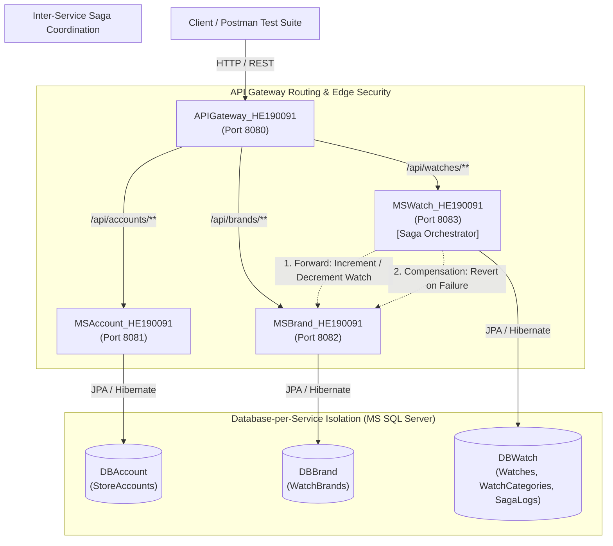
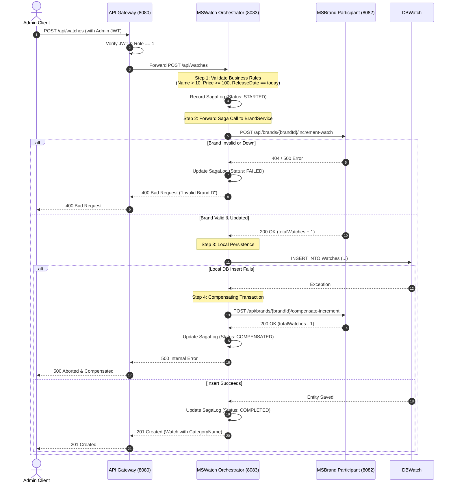

# Watch Management System - Microservices with Saga Pattern
### MSS301 - Distributed Systems & Microservices (Assignment 02)
**Student Code**: `HE190091`

---

## 1. System Architecture Overview

This project implements an enterprise distributed microservices system for a watch store adhering to the **Database-per-Service** and **Saga Pattern** architecture.



### Component Breakdown
| Microservice | Port | Database | Primary Responsibility |
| :--- | :---: | :---: | :--- |
| **`APIGateway_HE190091`** | `8080` | None | Single entry point, path routing, JWT validation & Admin role enforcement. |
| **`MSAccount_HE190091`** | `8081` | `DBAccount` | User authentication, account lifecycle, JWT issuance. |
| **`MSBrand_HE190091`** | `8082` | `DBBrand` | Watch brand catalog and Saga participant (counter & compensation). |
| **`MSWatch_HE190091`** | `8083` | `DBWatch` | Watch & category management, business validation, **Saga Orchestrator**. |

---

## 2. Database Design & Code-First Schema

Each microservice manages its own dedicated schema using **Hibernate Code-First** (`@Entity` classes with `ddl-auto=update`).

### `DBAccount`
* **`StoreAccounts`**
  * `AccountID`: `INT IDENTITY(1,1) PRIMARY KEY`
  * `Username`: `VARCHAR(20) NOT NULL UNIQUE`
  * `Email`: `VARCHAR(100) NOT NULL UNIQUE`
  * `Password`: `VARCHAR(100) NOT NULL`
  * `Role`: `INT NOT NULL` (1: Administrator, 2: Staff, 3: Member)
  * `IsActive`: `BIT NOT NULL DEFAULT 1`

### `DBBrand`
* **`WatchBrands`**
  * `BrandID`: `INT IDENTITY(1,1) PRIMARY KEY`
  * `BrandName`: `VARCHAR(200) NOT NULL`
  * `CountryOfOrigin`: `VARCHAR(50) NOT NULL`
  * `TotalWatches`: `INT NOT NULL DEFAULT 0` (Maintained via Saga)

### `DBWatch`
* **`WatchCategories`**
  * `CategoryID`: `INT IDENTITY(1,1) PRIMARY KEY`
  * `CategoryName`: `VARCHAR(100) NOT NULL`
  * `Description`: `NVARCHAR(MAX)`
  * `MovementType`: `VARCHAR(50)`
  * `PriceRange`: `VARCHAR(100)`
* **`Watches`**
  * `WatchID`: `INT IDENTITY(1,1) PRIMARY KEY`
  * `Name`: `VARCHAR(255) NOT NULL`
  * `CategoryID`: `INT NOT NULL` (Foreign Key $\to$ `WatchCategories.CategoryID`)
  * `BrandID`: `INT NOT NULL` (Logical reference $\to$ `WatchBrands.BrandID`)
  * `CaseMaterial`: `VARCHAR(100) NOT NULL`
  * `StrapMaterial`: `VARCHAR(100) NOT NULL`
  * `WaterpMaterial`: `VARCHAR(50) NOT NULL`
  * `Price`: `DECIMAL(10,2) NOT NULL`
  * `ReleaseDate`: `DATE NOT NULL`
  * `Stock`: `INT NOT NULL`
* **`SagaLogs`**
  * `SagaID`: `VARCHAR(64) PRIMARY KEY`
  * `ActionType`: `VARCHAR(30) NOT NULL` (`CREATE_WATCH`, `UPDATE_WATCH`, `DELETE_WATCH`)
  * `WatchID`: `INT`
  * `BrandID`: `INT`
  * `Status`: `VARCHAR(30) NOT NULL` (`STARTED`, `COMPLETED`, `COMPENSATING`, `COMPENSATED`, `FAILED`)
  * `Details`: `VARCHAR(1000)`
  * `CreatedAt`: `DATETIME2 NOT NULL`

---

## 3. Seed Data (Pre-Populated on Startup)

Upon first launch, `DataInitializer` seeds exact data specified in the assignment:
* **5 Accounts**: `adminsys` (Admin, Active), `staff02` (Staff, Active), `member01` (Member, Active), `member02` (Member, Inactive), `staff01` (Staff, Inactive).
* **5 Categories**: Dive Watches, Chronograph Watches, Dress Watches, Digital Watches, Pilot Watches.
* **5 Brands**: Rolex (Switzerland), Omega (Switzerland), Seiko (Japan), Casio (Japan), TAG Heuer (Switzerland).
* **10 Watches**: Submariner Date, Speedmaster Moonwatch, Presage Cocktail Time, G-Shock, Carrera Calibre, Seamaster Diver, Prospex SPB143, Daytona, F-91W, IWC Pilot's Watch.

---

## 4. Saga Pattern Workflow Design



---

## 5. Quick Start & Execution Guide

### Prerequisites
* **Java 21**
* **Maven 3.8+**
* **Docker & Docker Compose** (for MS SQL Server)

### Step 1: Start MS SQL Server & Initialize Databases
```bash
docker compose up -d mssql
```
*Port `1433` will be opened with credentials `sa` / `YourStrong@Password123`.*
*The 3 independent databases (`DBAccount`, `DBBrand`, `DBWatch`) are initialized automatically.*

### Step 2: Build All Microservices
```bash
mvn clean package -DskipTests
```

### Step 3: Run the Services
You can run each service individually in **IntelliJ IDEA** (open each submodule directory or root) or run the one-click startup script:
```bash
chmod +x scripts/*.sh
./scripts/start-all.sh
```

To stop all services:
```bash
./scripts/stop-all.sh
```

### Dual Profile Support (Zero-Dependency H2 Fallback)
If you prefer to run without Docker or SQL Server, each service includes an `h2` profile with MSSQL compatibility mode:
```bash
java -jar -Dspring.profiles.active=h2 MSAccount_HE190091/target/MSAccount_HE190091-1.0.0.jar
java -jar -Dspring.profiles.active=h2 MSBrand_HE190091/target/MSBrand_HE190091-1.0.0.jar
java -jar -Dspring.profiles.active=h2 MSWatch_HE190091/target/MSWatch_HE190091-1.0.0.jar
java -jar APIGateway_HE190091/target/APIGateway_HE190091-1.0.0.jar
```

---

## 6. Testing with Postman & Newman

A complete test suite is provided in [`postman/`](file:///media/simpi/program-files/Program%20Files/Documents/Study/Code/MSS301/Assigment_02_FA26/postman):
* **Collection**: `MSS301_Assignment2_WatchManagement_Saga.postman_collection.json`
* **Environment**: `MSS301_Assignment2_Environment.postman_environment.json`

### Automated Run via Newman
```bash
npx --yes newman run postman/MSS301_Assignment2_WatchManagement_Saga.postman_collection.json \
  -e postman/MSS301_Assignment2_Environment.postman_environment.json
```
**Test Results: 28/28 requests passed, 48/48 assertions verified (0 failures).**

### Test Scenarios Covered
1. **Public Catalog Access**: `GET /api/watches` accessible without tokens, returns enriched `categoryName`, displays newest items at the top.
2. **Authentication Flow**: Login for Admin (Role 1), Staff (Role 2), Member (Role 3), and rejection for Inactive accounts (`member02`).
3. **Authorization Guards**: Unauthenticated requests return `401 Unauthorized`; Staff/Member mutations return `403 Forbidden`.
4. **Strict Business Validations**:
   * Name length $\le$ 10 $\to$ `400 Bad Request`
   * Price < 100 $\to$ `400 Bad Request`
   * ReleaseDate $\ne$ Current date $\to$ `400 Bad Request`
5. **Saga Create Flow**: Creates watch, increments `totalWatches` in MSBrand, places new item at top of list.
6. **Saga Update Flow**: Updates watch details, decrements old brand count, increments new brand count.
7. **Saga Compensation on Failure**: Non-existent `brandId` safely aborts transaction without persisting orphaned watch.
8. **Saga Delete Flow**: Deletes watch, decrements brand count in MSBrand, restores on failure.
